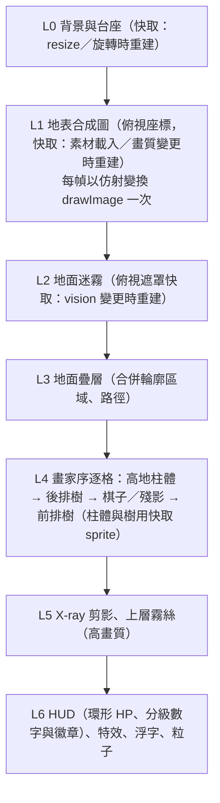

# 【臨時文件】2.5D 高清圖視覺強化更新計畫

> [!WARNING]
> **本目錄 `_tmp_hd25d_upgrade/` 為臨時施工文件（含本檔與 `ref/` 參考圖），非正式專案文件。**
> 全部階段（P0～P4）完成並通過驗收後，必須依「§11 收尾清理程序」**整個目錄刪除**，並移除 [`PROGRESS.md`](../PROGRESS.md) 中指向本檔的導航連結；長期有效的結論改寫入 `README.md`／`AGENTS.md`／`PROGRESS.md`。
> 本目錄未列入 [`.github/workflows/pages.yml`](../.github/workflows/pages.yml) 的發佈清單，不會被部署。

- **建立日期**：2026-11-23
- **對象模組**：[`render/board-25d.js`](../render/board-25d.js)（主要）、[`index.html`](../index.html)（少量橋接與工具列）、新增 `assets/hd25d/`（PNG 素材）
- **不動範圍**：`core/*.js`、`ai/*.js`、`tools/*.mjs`、回放格式、戰略圖 DOM

---

## 實作與驗收狀態（2026-11-24，臺北時間）

- P0～P4 的程式與 26 張正式 PNG 已整合。數值標籤優先顯示選中／懸停棋子，其餘依可用空間排版。手機可點「顯示數值」。自動降級只取樣鏡頭操作期間。
- 高地頂面降至 `th × 0.47`，崖面繪製與點格共用地形高度差。以共邊相鄰計算，現行地圖有六片森林。戰術提示只用目前視角可取得的合法移動與攻擊資訊。
- 迷霧只處理該視角可見的資料。移動可見段保留斷點，切換視角與回放跳轉重置暫存。傷害浮字、受擊、陣亡與反擊跟隨各自命中時間。
- Chromium 回歸通過四方向 400/400 格心、手機模擬 32/32 開局棋子點選、畫質自動降級、迷霧像素對照、缺素材、0-AI 與 v1 回放。DPR 2 的雲端 Chromium 高畫質拖曳為 58.2 FPS，390×844 觸控模擬標準畫質為 55.8 FPS。
- 待完整驗收的項目為實機效能與 `file://` 瀏覽器直開。受管理的 Chromium 封鎖 `file://` 導覽，已在 Node 驗證載入器會走程序繪圖分支。

## 1. 已拍板決策（2026-11-23，使用者確認）

| # | 決策 | 內容 |
|---|---|---|
| D1 | **允許 PNG 素材入庫** | 棋子與裝飾圖可用預先繪製的 PNG，放在 `assets/hd25d/`（本機靜態檔，不是外部 CDN，仍符合零建置鏈）。這項決定取代原規格中「純原生 Canvas 2D 純造型兵種」的限制 |
| D2 | **計畫文件採臨時檔** | 就是本目錄。完工後清理 |
| D3 | **HUD 分級顯示** | 血條改為底座環形 HP；`hp/max` 數字與 `+N`／`★`／`夾` 徽章平時隱藏，只在**懸停、選中、縮放 ≥ 140%，或按住 Alt** 時顯示 |
| D4 | **畫質切換** | 提供「標準／高」兩檔，偏好記憶在 `localStorage`，效能不足時自動降級 |
| D5 | **執行範圍** | P0～P4 全部執行（順序見 §9） |

---

## 2. 參考圖（臨時）

| 檔案 | 說明 |
|---|---|
| [`ref/baseline_100.jpg`](./ref/baseline_100.jpg) | 改版前基準：100% 全景（headless Chrome 1440×1000、DPR 2、預設旋轉） |
| [`ref/baseline_166_blue.jpg`](./ref/baseline_166_blue.jpg) | 改版前基準：166% 藍方陣線特寫，可看到 HUD 互疊與高地木箱感 |
| [`ref/target_concept.jpg`](./ref/target_concept.jpg) | 目標風格概念圖（AI 生成），**只參考風格**，地形配置不精確 |

每個階段完成後，都要用相同視角補拍 `ref/after_Px_*.jpg` 做前後對照（壓成 JPG，寬 1100px，約 100KB 以內）。

---

## 3. 現況診斷摘要（改版前）

| 類別 | 問題 | 主要成因 |
|---|---|---|
| 棋子 | A1 HUD 互疊（開局 3×2 陣型時旗手幾乎看不到）、A2 造型扁平、A3 被遮擋時沒有提示、A4 沒有待機／動作／陣亡動畫、A5 陣營只靠顏色區分 | `drawUnitHud` 把標籤固定貼在底座兩側；`drawUnitSculpt` 多用單色填充 |
| 地圖 | B1 迷霧是逐格硬邊菱形、B2 光影太弱、B3 背景空蕩、B4 戰術疊層逐格畫框像馬賽克、B5 旋轉瞬間跳 90°、B6 待機時每秒 24 幀全圖重繪，沒有效能餘裕 | `drawFogOverlay` 逐格畫；`loop()` 每幀重建所有漸層 |
| 地形 | C1 高地逐格成箱、有接縫、岩紋像磚、C2 不同地形之間硬切、C3 每格固定 4 棵樹（像樹盆）、C4 雙色棋盤格加逐格描邊 | `drawTileBase`、`drawForestCluster` 只看單格，不看鄰格 |

---

## 4. 必要背景資料

### 4.1 地圖資料（來自 `core/engine.js`，180° 中心對稱）

- `HILL_COORDS`：`(4,4) (5,4) (4,5) (5,5)` 中央 2×2 台地；`(1,4) (2,4)`、`(7,5) (8,5)` 左右兩組 1×2 台地
- `FOREST_COORDS`：`(2,2) (3,2) (2,3)`、`(7,7) (6,7) (7,6)`、`(7,3) (8,3) (6,4)`、`(2,6) (1,6) (3,5)`，共六片以格邊相連的林地

```
     x→ 0 1 2 3 4 5 6 7 8 9
y=0     . . . . . . . . . .
y=1     . . . . . . . . . .
y=2     . . F F . . . . . .
y=3     . . F . . . . F F .
y=4     . H H . H H F . . .
y=5     . . . F H H . H H .
y=6     . F F . . . . F . .
y=7     . . . . . . F F . .
y=8     . . . . . . . . . .
y=9     . . . . . . . . . .
```

> 台地自動拼接（C-1）會遇到的情況：2×2 方塊（有內凹與外凸角）、1×2 長條。森林有兩組 L 形三格、兩組二格與兩座只在斜角接觸其他林格的單格林。

### 4.2 現有渲染度量（`getMetrics()`）

- `tw = min(width × 0.094, height × 0.162)`、`th = tw × 0.5`、`elevH = th × 0.47`
- 1440×1000 視窗下畫布為 778×583 CSS px，`tw ≈ 73px`
- 縮放範圍 `0.85～2.4`；DPR 上限為 2。**最大縮放時一格菱形寬約 351 個裝置像素**
- 棋子比例 `s = clamp(tw / 66, 0.52, 1.32)`。現有造型最高約 45s（旗桿頂），最大縮放時約 240 裝置像素

### 4.3 現有渲染管線（函式導航，改寫前要先讀過）

| 函式 | 職責 | 改版去向 |
|---|---|---|
| `getMetrics` / `projectBase` / `projectFloatBase` / `toRotated` / `fromRotated` | 投影與旋轉 | 擴充成支援連續角度 θ（P4），離散版本保留 |
| `hitTestTileAnalytic` / `pickTileAtClient` | 逆畫家序解析點格 | **邏輯幾何不變**；旋轉動畫進行中暫停點格 |
| `drawDioramaPlinth` | 台座與座標刻度 | P4 加外圍遠景 |
| `drawTileBase` | 逐格地表與岩壁 | P1 拆成「地表合成層」與「高地柱體快取」 |
| `drawPineTree` / `drawForestCluster` | 程序松樹 | P1 改成 PNG 道具並連片，程序版保留作為退路 |
| `drawFogOverlay` / `drawForestConcealOverlay` | 迷霧與「隱」標記 | P3 改成軟邊遮罩；「隱」標記保留 |
| `drawTileTacticalOverlays` | ZoC、可達、攻擊、回放標記等疊層 | P3 改為合併區域輪廓 |
| `drawUnitSculpt` / `drawUnitMiniature` / `drawUnitHud` | 棋子與 HUD | P2 改成 PNG sprite、環形 HP、分級 HUD，程序版保留作為退路 |
| `pruneAndSampleEffects` / `drawForegroundEffects` / `drawFloatTexts` | 特效 | P2 加姿態與陣亡；迷霧可見性判定沿用 |
| `drawFrame` / `loop` / `needsContinuousAnimation` | 主幀 | P0 改成分層快取管線 |

### 4.4 `index.html` 的橋接點

- `buildBoard25dScene(view, selUnit, ghostAt)` 產生 scene，欄位包括 `visibleUnitsByKey`、`ghostsByKey`、`vision`、`zocKeys`、`reachableKeys`、`chargeKeys`、`attackableIds`、`unitMetaById`、`markersByKey` 等
- `emitBoard25dEffect(fx)`（回放中不發送）。目前有三種效果：
  - `move`：`unitId, faction, steps[{x,y,observed}], isCharge`
  - `attack`：`attackerId, targetId, attackerType, attackerFaction, from/to, attackerObserved, isCharge, isShattered, isCounter, viewers`
  - `ambush`
- 鏡頭工具列 DOM：`#hdZoomBadge`、`#hdControlHint`（約在 `#board25dHost` 附近），快捷鍵為 `Q`／`E`／`R`／`+`／`-`

---

## 5. 素材規格（`assets/hd25d/`，正式永久目錄）

### 5.1 目錄與清單

```
assets/hd25d/
├── units/      blue_flag.png  blue_shield.png  blue_spear.png  blue_archer.png  blue_cavalry.png
│               red_flag.png   red_shield.png   red_spear.png   red_archer.png   red_cavalry.png
├── terrain/    grass.png  forest_floor.png  hilltop.png  cliff_face.png  fog_cloud.png
└── props/      pine_a.png  pine_b.png  pine_c.png  bush_a.png  bush_b.png  fern.png
                rock_a.png  rock_b.png  rubble.png  flowers.png  grass_tuft.png
```

### 5.2 尺寸與錨點

| 類別 | 畫布 | 錨點 | 規格 |
|---|---|---|---|
| 棋子 `units/*` | 384×384 | (50%, 88%) 為雙腳／馬蹄接地中心 | 3/4 側前視角、**面朝畫面右方**（左向由程式水平翻轉）；主體高約 300px；**不含底座與落地陰影**（底座、環形 HP、陣營徽記都由程式繪製）；透明背景；光源在左上 |
| 地表貼圖 `grass` / `forest_floor` / `hilltop` | 512×512 | 無 | **正俯視**、四方向無縫可平鋪；低對比，不搶棋子視覺 |
| 崖面 `cliff_face` | 512×192 | 頂緣 = 台地邊 | 正視岩層斷面，**水平無縫**；頂緣帶垂草，底部漸暗 |
| 霧 `fog_cloud` | 512×512 | 無 | 白色雲團加 alpha 通道，四方向無縫 |
| 松樹 `pine_*` | 256×384 | (50%, 94%) 樹幹接地點 | 3 種輪廓變體，不含陰影 |
| 灌木、蕨、石、碎石、花、草簇 | 96～192 寬 | 底部中心 | 不含陰影 |

- **容量預算**：素材合計 ≤ 2.0 MB（單張棋子 ≤ 80KB、地表貼圖 ≤ 180KB）。PNG 要經過最佳化（PIL `optimize=True`，必要時降色）
- **陣營配對**：先產出藍方版本；紅方版本由同一張圖做**色相遮罩換色**（只換飽和藍色區段，金屬、膚色、木頭、金色不動），確保兩方輪廓完全一致

### 5.3 產製流程（以 AI 生成為主，腳本放暫存目錄，**不入庫**）

1. 以 `ref/target_concept.jpg` 作為風格參考圖，每類素材固定使用同一組風格敘述：stylized fantasy tabletop miniature、clean shading、light from upper-left、dark thin outline。
2. 生成時背景用**純洋紅 `#FF00FF`**，方便去背（避免用綠色，會跟草地、松樹的顏色衝突）。
3. 用 Python PIL 去背：洋紅色距加上軟邊 alpha、去除邊緣溢色（despill）、裁切留白、縮放並填補到規格畫布、對齊錨點、最佳化輸出。
4. 無縫貼圖：先位移半張，再對接縫做交叉羽化，最後目視檢查平鋪 3×3 的效果。
5. 紅方換色：在 HSV 色相 195°～255°、飽和度 > 0.35 的遮罩內，把色相平移到 355°～5°，並微調亮度。
6. 每張素材都要在**實際遊戲畫面**中檢查四個旋轉方向與 85%、100%、240% 三種縮放。

### 5.4 載入與退路（硬性要求）

- 素材清單由 `board-25d.js` 內部常數 `HD_ASSETS` 定義（屬於渲染器內部資源，跟「禁止寫死 AI 清單」無關）。
- 基底路徑在腳本載入時以 `document.currentScript.src` 解析成 `../assets/hd25d/`，取不到時退回 `assets/hd25d/`，以相容 GitHub Pages 子路徑與 `file://`。
- 用 `Promise.allSettled` 非同步載入。**任何素材缺失、載入失敗或尚未載入時，自動改用現有程序繪製**。刪空整個 `assets/hd25d/` 時，2.5D 圖要零報錯，並退回現行外觀。
- 在 Node 環境（`typeof Image === 'undefined'`）不載入素材。
- **`file://` 汙染地雷**：在 `file://` 下，把 PNG 畫進 canvas 會汙染該畫布，所以**禁止在任何畫過 PNG 的畫布上呼叫 `getImageData` / `toDataURL`**。需要像素運算的遮罩（迷霧、合併輪廓）只能在純程序繪製的畫布上做，或改用合成模式（`globalCompositeOperation`）實作。
- 要修改 [`.github/workflows/pages.yml`](../.github/workflows/pages.yml)，把 `assets/` 一起複製到 `_site/`（比照現有 `render/` 的 `compgen` 防呆寫法）。

---

## 6. 技術設計

### 6.1 分層渲染管線（P0）



- **快取失效時機**：
  - `L1`：素材載入完成或畫質切換時重建，**縮放、平移、旋轉都不需要重建**（只換仿射矩陣）。
  - `L2` 遮罩：vision 改變時重建（以 `tileVisible` 雜湊比對）。
  - 柱體／樹 sprite：依「旋轉方向 × 縮放級距 × 畫質」做鍵值快取，採 LRU、容量有上限。
- **待機省電**：沒有任何動畫需求時完全停止 rAF；只有飄霧與旗幟時，標準畫質 12fps、高畫質 24fps。

### 6.2 俯視地表合成 + 仿射投影（P1，地形過渡的核心）

- 在離屏畫布上以俯視座標合成整張地表，解析度標準畫質 96px／格（960²），高畫質 192px／格（1920²，約 14.7MB）。
  1. 整張用 `grass` 平鋪填滿。
  2. 林地：低解析度遮罩（32px／格）畫上林格，模糊約 0.2 格後，用雜訊閾值做出不規則邊界，再以 `destination-in` 遮出 `forest_floor`。
  3. 崖底過渡：在台地四周畫一圈 AO 暗帶，並撒上碎石。
  4. 加世界座標低頻色斑，打破重複感。
  5. 撒上地表道具：石、花、草簇，用決定性 hash 擺放，並避開格心半徑 0.3 格（格心是棋子站位）。
- 投影：等角投影 = 旋轉 45° 加 y 軸 0.5 倍縮放，屬於仿射變換。所以每幀只要 `setTransform(a,b,c,d,e,f)` 再 `drawImage` 一次，四個旋轉方向只差一個矩陣，連續角度 θ 也能直接套用。
- 格線：改成在合成圖上畫連續細線（11 條 × 2 方向），透明度隨縮放調整，提供開關（預設開，低透明度）。

### 6.3 高地台地自動拼接（P1）

- 每個高地格計算 8 鄰 bitmask：
  - **外露邊**（鄰格不是高地）：在可見的兩個前側面畫崖面，用 `cliff_face` 加斜切變換，頂緣抖動 ≤ 2px。
  - **內部邊**：不畫崖、不畫格線、不畫頂緣高光。
  - **外凸角**：圓角半徑 0.18 格。
  - **內凹角**：補一個角塊。
- 台地頂面：同樣用 `hilltop` 做俯視合成，依台地聯集輪廓（含圓角）裁切；在畫家序中**逐格以菱形裁切繪製**，保持跟棋子的正確遮擋順序。
- **邏輯頂面仍是原本的菱形**，`hitTestTileAnalytic` 不改。若崖面的視覺範圍超出原本岩壁判定區，要在驗收時確認不會誤點到後方格子。

### 6.4 連片森林（P1）

- 以世界座標做泊松盤取樣（最小間距 0.32 格，決定性種子）在每群林格內放樹，相鄰林格之間連成一片。
- **每棵樹歸屬於它所在的格子**：前後排分層、`softFade`、迷霧暗化、「隱」標記，全部沿用原本的逐格判定。
- 林緣朝草地一側撒 `bush` 和 `fern`。格內有棋子時，避開格心的樹木會讓位，這部分沿用現有的 `occupied` 邏輯。

### 6.5 棋子（P2）

- **Sprite 快取**：PNG 依「陣營 × 兵種 × 朝向（翻轉與否）× 縮放級距」預先縮放到快取畫布（高畫質為 2× 超取樣）。殘影版用 `source-in` 藍灰色調加掃描線預先生成。
- **程序底座**：立體圓盤加陣營造型（藍方圓形＋獅紋、紅方八角＋鷹紋，解決 A5），盤緣撒草簇。
- **環形 HP（D3）**：沿底座橢圓外圈繪製，弧長 = HP%，從 12 點鐘方向順時針；顏色門檻沿用現行（> 55% 綠、> 25% 黃、其餘紅）；HP ≤ 25% 時緩慢閃爍。
- **HUD 分級（D3）**：
  - `hp/max` 數字、`+N`、`★`、`夾` 合併成頭頂一列，只在**懸停、選中、縮放 ≥ 1.4 或按住 Alt** 時顯示。
  - Alt 的 `keydown` 要 `preventDefault`，視窗 `blur` 時重置狀態。
  - 平時的低噪提示：激勵（★）以底座金色反光表示，夾擊以環形 HP 外加紅色描邊表示。
  - 殘影的「N回前」標籤維持常駐（重要情報）。
- **X-ray 剪影（A3）**：棋子的包圍框跟之後畫的遮擋物（高地柱體、前排樹、前方棋子）重疊時，在 L5 用陣營色剪影描邊（alpha 0.5）補畫。
- **待機微動畫**：呼吸（Y 軸縮放 ±1.2%）、騎兵上下起伏 1px，依單位 hash 錯開相位。標準畫質只保留旗幟擺動；`prefers-reduced-motion` 時全部關閉。
- **動作姿態**：
  - 攻擊：攻方前衝 0.15 格再回位，只有 `canSeeOrigin` 時才播。
  - 受擊：後仰並紅閃，取代現行白閃。
  - **陣亡**：要在 `index.html` 的 `attack` 效果加上 `targetKilled` 與 `targetSnapshot{type,faction,x,y}`；反擊致死同理。渲染器以快照播放「倒下 → 碎裂淡出」約 600ms，**只對 `fx.viewers` 包含觀看者的一方播放**。
- **選取特效**：地面緩慢旋轉的符文圈（程序繪製），取代黃色橢圓。

### 6.6 迷霧（P3）

- **遮罩**：在純程序畫布上以俯視座標（32px／格）畫出可見格，**先外擴 0.12 格再模糊**，羽化範圍只落在迷霧格那一側，確保可見格完全清晰。模糊用多次縮放取樣實作（不依賴 `ctx.filter`，以相容 Safari）。
- **地面霧（L2）**：依反相遮罩在迷霧區塗上去飽和的藍灰色調，再疊 `fog_cloud`。高畫質用雙層視差飄移，標準畫質為靜態。
- **上層霧絲（L5，僅高畫質）**：輕薄的雲層蓋在迷霧格的樹冠上方；遮罩要扣除所有可見棋子與殘影的包圍框，避免把它們變暗。
- **消散動畫**：新揭露的格子用 300ms 淡出（由前後兩次 vision 差異計算，只涉及已可見的資訊）。
- **零洩密**：遮罩**只**由 `vision.tileVisible` 產生；迷霧格內本來就沒有任何單位資料（scene 不提供），羽化與動畫都不會帶出新情報。
- 「隱」標記與林內暗幕保留，風格上跟新迷霧統一。

### 6.7 戰術疊層合併（P3）

- 對 `reachableKeys`、`chargeKeys`、`zocKeys`、攻擊範圍等集合，計算格子聯集的**邊界邊並串成封閉迴圈**，向內縮 0.06 格並做圓角，畫成單一區域：半透明填色加流動虛線邊（reduced-motion 時改為靜態）。
- 高地與平地分開成兩組各自計算（因為高度不同）。
- 路徑終點改成箭頭，MP 氣泡保留。
- 單格標記（懸停、可攻擊脈動、伏擊、回放標記）維持逐格繪製。

### 6.8 氛圍與鏡頭（P4）

- **投影**：依光源方向（左上，換算 `camera.rot`）預先烘焙高地與樹木的長影子到 L1；棋子則即時畫接觸陰影。
- **背景**：台座外圍加遠景雲海或遠山剪影、四周暗角。
- **粒子**：花粉、螢火，數量 ≤ 24，僅高畫質。
- **旋轉轉盤動畫**：用連續角度 θ 做 250ms easeInOut；每幀依深度重新排序畫家序；動畫中暫停點格與懸停；reduced-motion 時直接切換。
- **移軸景深**：預設關閉，只作為高畫質的可選項（視效能決定是否保留）。

### 6.9 畫質切換（D4）

| 功能 | 標準 | 高 |
|---|---|---|
| 地表合成解析度 | 96px／格 | 192px／格 |
| Sprite 快取倍率 | 1×（乘 DPR） | 2× 超取樣 |
| 迷霧 | 軟邊遮罩、靜態雲紋 | 雙層視差飄移＋上層霧絲＋消散動畫 |
| 待機微動畫 | 僅旗幟 | 全部 |
| 粒子 | 關 | 開 |
| 待機幀率 | 12fps | 24fps |

- **UI**：在 2.5D 鏡頭工具列新增按鈕 `#hdQualityBtn`，文字為「畫質：高」或「畫質：標準」。
- **偏好**：存 `localStorage` 的 `tfc_hd_quality_v1`（值為 `'high'` 或 `'standard'`）。
- **預設值**：`matchMedia('(pointer: coarse)')` 成立或 `navigator.deviceMemory ≤ 4` 時預設標準，其餘預設高。
- **自動降級**：在高畫質下，若鏡頭操作期間取樣的 90 個幀間隔平均 > 28ms，就自動切到標準，並在 `#hdControlHint` 提示一次（同一分頁只提示一次，不覆寫使用者手動設定的偏好）。
- 新增的 DOM `id` 都要對應實際 HTML，並通過 AGENTS.md 第五節第 3 點的 ID 檢查。

---

## 7. 不變量對照與風險

| 項目 | 防護措施 |
|---|---|
| 迷霧零洩密 | 迷霧遮罩、陣亡、消散、姿態動畫全部套用 `viewers` 或 `tileVisible` 判定；每個階段都要做藍方、紅方、全圖三視角審計 |
| 零 DOM 破壞 | 全部在 Canvas 內完成；`index.html` 只新增一顆畫質按鈕和效果欄位 |
| 引擎與 AI 鎖定 | 不動 `core/`、`ai/`；仍要跑 `verify-ai.mjs` 與 `arena.mjs` 做回歸 |
| 回放 v1 | 渲染器只吃 scene；回放中本來就不發效果，所以陣亡動畫在回放中不播（維持現況） |
| 0 素材 | 刪空 `assets/hd25d/` 時要退回程序繪製且零報錯 |
| 效能 | 記憶體上限：高畫質快取總量 ≤ 64MB；手機 390×844 在標準畫質要維持 ≥ 30fps 互動 |
| 風險：AI 素材風格不一 | 固定參考圖與風格敘述；每批素材都要放進實際畫面比對，不合格就重生 |
| 風險：崖面視覺超出判定區 | 抖動限制 ≤ 2px；驗收時點格回歸要包含高地後方的平地格（例如 `(8,4)`） |
| 風險：`file://` 畫布汙染 | 見 §5.4 的地雷規則 |

---

## 8. 驗收標準

1. **可讀性**：開局 3×2 陣型在 100% 縮放下，六個棋子的輪廓都能辨識，旗手不被 HUD 遮住；懸停或選中時能看到完整數字與徽章。
2. **地形**：中央 2×2 台地看起來是一整塊，內部沒有接縫；草地與林地、草地與崖底之間沒有硬切的菱形邊；森林連成一片。
3. **迷霧**：可見區與迷霧區之間是軟邊過渡，可見格完全清晰；三視角審計沒有洩密。
4. **互動回歸**：四個旋轉方向的點格正確、高地後方平地點擊正確、6px 防誤觸、游標中心縮放、方案 C 懸停小窗位置正確。
5. **退路**：刪空 `assets/hd25d/` 與 `file://` 直接開啟都能零報錯運作。
6. **效能**：桌機高畫質互動維持 60fps；待機時 CPU 明顯低於改版前（用 Performance 面板比對）；手機標準畫質 ≥ 30fps。
7. **既有檢查**：`node tools/verify-ai.mjs`、`node tools/arena.mjs`、語法與 DOM ID 檢查、0-AI 與回放相容性檢查全部通過。

---

## 9. 階段任務清單

### P0｜基礎建設
- [x] `HD_ASSETS` 載入器（`allSettled`、基底路徑解析、Node 防護、載入完成後讓快取失效）
- [x] 分層管線骨架（L0～L6）與快取失效機制；待機時停止 rAF 或降低幀率
- [x] 畫質切換（`#hdQualityBtn`、`tfc_hd_quality_v1`、預設值判斷、自動降級）
- [x] `pages.yml` 加入 `assets/` 複製
- [x] 素材產製流程打通（先做 1 張棋子與 1 張貼圖完成端到端驗證）

### P1｜地形重構
- [x] 素材：`grass`、`forest_floor`、`hilltop`、`cliff_face`、`pine_a/b/c`、`bush_a/b`、`fern`、`rock_a/b`、`rubble`、`flowers`、`grass_tuft`
- [x] 俯視地表合成與仿射投影；連續格線
- [x] 高地台地 bitmask 拼接、圓角、崖面、崖底 AO 與碎石
- [x] 泊松連片森林與林緣灌木
- [x] 地形對照 [畫面](./ref/after_P1_terrain.jpg)，點格回歸

### P2｜棋子與 HUD
- [x] 素材：10 張 `units/*`（藍方生成、紅方換色）
- [x] Sprite 快取、程序陣營底座、環形 HP、分級 HUD 與 Alt 鍵、低噪提示
- [x] X-ray 剪影；待機微動畫；攻擊、受擊、陣亡姿態（`index.html` 補 `targetKilled`／`targetSnapshot`）
- [x] 殘影全息風格、選取符文圈
- [x] 手機棋子與 HUD [畫面](./ref/after_P2_mobile.jpg)，三視角洩密審計

### P3｜迷霧與疊層
- [x] 素材：`fog_cloud`
- [x] 軟邊遮罩、地面霧、上層霧絲、消散動畫
- [x] 合併區域輪廓（可達、衝鋒、ZoC、攻擊範圍）、路徑箭頭
- [x] 單方迷霧 [畫面](./ref/after_P3_fog.jpg)，三視角洩密審計

### P4｜氛圍與鏡頭
- [x] 烘焙投影、接觸陰影、暗角、遠景背景、粒子
- [x] 連續角度旋轉轉盤動畫
- [x] 雲端桌機與手機模擬效能量測、畫質參數微調
- [x] 改版後桌機 100% [全景](./ref/after_P4_desktop.jpg)

> 每個階段完成後：依 AGENTS.md 第五節驗證 → 更新本檔勾選狀態與 `PROGRESS.md` 進度 → `git commit` 並 `git push origin main`。

---

## 10. 完工時要同步的正式文件

- **`README.md`**：2.5D 高清圖的描述（PNG 素材、環形 HP 與分級 HUD、Alt 鍵、畫質切換、旋轉動畫），目錄樹加入 `assets/`。
- **`AGENTS.md`**（技術同步類更新，D1 已獲使用者授權）：
  - 第三節的 2.5D 規格由「純原生 Canvas 2D …純造型兵種」改為「Canvas 2D ＋本地 PNG 素材（`assets/hd25d/`），素材缺失時自動退回程序繪製」。
  - 補記地雷：`file://` 畫布汙染時禁止 `getImageData`／`toDataURL`；`pages.yml` 必須複製 `assets/`；崖面視覺不得超出點格判定區。
  - 第四節導航加入 `assets/hd25d/`。
- **`PROGRESS.md`**：快照、關鍵決策（D1～D5 定案內容）、驗證數據、對話紀錄。

---

## 11. 收尾清理程序（全部完成後執行）

1. 確認 §9 全部勾選、§8 驗收全部通過。
2. 把長期有效的內容寫進 §10 列出的正式文件。
3. `git rm -r _tmp_hd25d_upgrade/`（包含本檔與 `ref/` 參考圖）。
4. 移除 `PROGRESS.md` 中指向本檔的臨時導航連結，並在對話紀錄註明「臨時計畫文件已清理」。
5. 確認 `git status` 乾淨後 commit 並 `git push origin main`。
